# Modelo de datos

MariaDB 11, InnoDB, `utf8mb4_unicode_ci`. Dinero en `DECIMAL(14,2)`, fechas en UTC. El esquema completo está en
[`db/schema.sql`](../db/schema.sql) y se crea con las migraciones de EF Core.

```mermaid
erDiagram
    empresa ||--o{ caja : tiene
    caja ||--o{ ahorrador : agrupa
    caja ||--o{ periodo : "calendario de nómina"
    caja ||--o{ ciclo : "cierre anual"
    caja ||--o{ prestamo : otorga
    caja ||--o{ movimiento : registra
    caja ||--o{ layout_generado : produce
    usuario ||--o{ usuario_caja : "acceso a"
    caja ||--o{ usuario_caja : "asignada a"
    usuario ||--o{ refresh_token : sesiones
    usuario ||--o{ importacion : carga
    usuario |o--o{ prestamo : autoriza

    ahorrador ||--o{ cuota_ahorro : "historial de cuotas"
    ahorrador ||--o{ movimiento : mueve
    ahorrador ||--o{ prestamo : solicita
    ahorrador |o--o{ prestamo : avala
    ahorrador ||--o{ incidencia : tiene
    ahorrador ||--o{ ciclo_distribucion : recibe

    periodo ||--o{ movimiento : "se aplica en"
    periodo ||--o{ incidencia : "ocurre en"
    periodo ||--o{ prestamo_amortizacion : "se descuenta en"
    periodo ||--o{ interes_devengado : "se devenga en"

    prestamo ||--|{ prestamo_amortizacion : "tabla de amortización"
    prestamo ||--o{ movimiento : "desembolso y abonos"
    prestamo ||--o{ interes_devengado : devenga

    ciclo ||--o{ ciclo_distribucion : reparte
    ciclo ||--o{ layout_generado : "layout SPEI"
    importacion ||--o{ importacion_detalle : renglones
    tarea_programada ||--o{ tarea_ejecucion : historial

    empresa { int id PK
        string nombre UK
        bool activa }
    caja { int id PK
        int empresa_id FK
        string nombre
        string prefijo "GIM, ACE, TDB"
        decimal tasa_interes_mensual "CHECK 1.00 a 2.00"
        enum frecuencia_nomina
        date inicio_ciclo
        date fin_ciclo
        bool activa }
    usuario { int id PK
        string nombre
        string correo UK
        string hash_password
        enum rol "ADMINISTRADOR, CAPTURISTA, CONSULTA"
        bool acceso_todas_cajas
        bool activo
        datetime ultimo_acceso }
    ahorrador { int id PK
        int caja_id FK
        string num_empleado "UK con caja_id"
        string nombre
        string apellidos
        string rfc
        date fecha_nacimiento
        date fecha_ingreso
        date fecha_baja
        enum estado "ACTIVO, LICENCIA, BAJA"
        decimal sueldo_quincenal
        char clabe "18 dígitos"
        string departamento }
    cuota_ahorro { int id PK
        int ahorrador_id FK
        decimal cuota_ordinaria
        decimal cuota_voluntaria
        bool voluntario_activo
        date vigente_desde "UK con ahorrador_id" }
    periodo { int id PK
        int caja_id FK
        int anio
        int numero "1 a 24"
        date fecha_inicio
        date fecha_fin "fecha de pago"
        enum estado "ABIERTO, APLICADO, CERRADO" }
    movimiento { bigint id PK
        int caja_id FK
        int ahorrador_id FK
        int periodo_id FK
        int prestamo_id FK
        date fecha
        enum tipo
        decimal monto "siempre mayor a cero"
        string referencia }
    prestamo { int id PK
        string folio UK "FOL-AAAA-NNN"
        int caja_id FK
        int ahorrador_id FK
        decimal monto
        int plazo_quincenas
        decimal tasa_mensual
        enum garantia "AHORRO_80, PAGARE_AVAL"
        int aval_ahorrador_id FK
        decimal excedente_aval "parte del monto que respalda el aval"
        enum estado
        date fecha_solicitud
        date fecha_autorizacion
        int autorizado_por FK }
    prestamo_amortizacion { bigint id PK
        int prestamo_id FK
        int numero "UK con prestamo_id"
        int periodo_id FK
        date fecha
        decimal capital
        decimal interes
        decimal total
        decimal saldo_despues
        enum estado "PROYECTADO, PROGRAMADO, APLICADO" }
    incidencia { int id PK
        int ahorrador_id FK
        int periodo_id FK
        enum tipo
        decimal valor
        string nota }
    ciclo { int id PK
        int caja_id FK
        int anio "UK con caja_id"
        enum estado "ABIERTO, EN_CIERRE, CERRADO"
        decimal interes_total
        datetime fecha_cierre }
    ciclo_distribucion { int ciclo_id PK
        int ahorrador_id PK
        decimal saldo_dias
        decimal saldo_promedio
        int dias_activos
        decimal participacion "0 a 1, 6 decimales"
        decimal interes_asignado
        decimal ahorro_liquidado
        decimal ahorro_retenido "garantía de préstamos vigentes que pasa al ciclo siguiente" }
    interes_devengado { bigint id PK
        int prestamo_id FK
        int periodo_id FK
        date fecha_corte "UK con prestamo_id"
        decimal saldo_insoluto
        decimal interes }
    layout_generado { int id PK
        enum tipo "NOMINA, SPEI"
        int caja_id FK
        int periodo_id FK
        int ciclo_id FK
        string formato
        string nombre_archivo
        int registros
        decimal importe_total
        int usuario_id FK
        datetime fecha }
    importacion { int id PK
        int caja_id FK
        string archivo
        enum formato
        int usuario_id FK
        datetime fecha
        enum estado }
    importacion_detalle { bigint id PK
        int importacion_id FK
        int numero_fila
        enum tipo "ALTA, BAJA, SIN_CAMBIO"
        string num_empleado
        longtext datos
        enum validacion
        string mensaje_error }
    tarea_programada { int id PK
        string clave UK
        string nombre
        enum frecuencia
        time hora
        bool activa
        datetime ultima_ejecucion
        datetime proxima_ejecucion }
    tarea_ejecucion { bigint id PK
        int tarea_id FK
        datetime inicio
        datetime fin
        enum estado
        string resumen }
    usuario_caja { int usuario_id PK
        int caja_id PK }
    refresh_token { bigint id PK
        int usuario_id FK
        string token_hash UK
        datetime creado
        datetime expira
        datetime revocado }
```

## Tipos de movimiento

| Tipo | Efecto en el ahorro | Nota |
|---|---|---|
| `AHORRO_ORDINARIO` | suma | descuento de nómina obligatorio |
| `AHORRO_VOLUNTARIO` | suma | siempre en renglón aparte del ordinario |
| `LIQUIDACION_CICLO` | resta | pago del ahorro (cierre de ciclo o baja); deja el saldo en cero |
| `DESEMBOLSO_PRESTAMO`, `ABONO_CAPITAL`, `ABONO_INTERES` | ninguno | pertenecen al préstamo (`prestamo_id`) |
| `INTERES_ANUAL` | ninguno | rendimiento asignado al cerrar el ciclo; se dispersa por SPEI |

## Objetos programables

| Objeto | Para qué |
|---|---|
| `fn_saldo_ahorro(ahorrador, fecha)` | ahorro acumulado a una fecha |
| `v_saldo_ahorrador` | ordinario, voluntario y total del ciclo en curso (posterior a la última liquidación) |
| `v_prestamo_resumen` | capital e interés pagados, saldo vigente y cuotas restantes por préstamo |
| `v_estado_cuenta` | movimientos con su efecto y el saldo corrido (función de ventana) |
| `v_descuento_periodo` | descuento de nómina por ahorrador y periodo respetando incidencias |
| `sp_calcular_interes_devengado(caja, fecha_corte)` | lo invoca la tarea programada; idempotente |
| `sp_saldo_dias_ciclo(ciclo)` | saldo-días, saldo promedio y días activos del ciclo (borrador recalculable) |

Los `.sql` viven en [`db/objetos`](../db/objetos) y la migración `ObjetosSql` los aplica.
